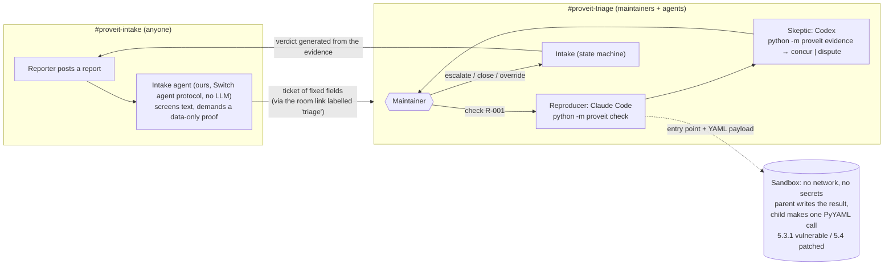

# Prove It

**AI spam is drowning open source. Prove It makes the AI prove its bug report before a human reads it.**

**Code decides, agents argue, humans rule.** The verdict comes from deterministic sandbox evidence, never from a language model's opinion. The agents run the investigation, challenge the evidence and explain it in the room. A maintainer makes every final call.

Built by Team Pikachu for the [Flip the Switch hackathon](https://www.wemakedevs.org/hackathons/switch), Track 1: Best Business Workflow. MIT licensed.

## The problem

Writing a plausible vulnerability report now takes an AI ten seconds. Checking one still takes a maintainer an hour. In 2026 that imbalance started shutting programs down: curl [ended its bug bounty](https://www.theregister.com/2026/01/21/curl_ends_bug_bounty/) in January after its confirmed-vulnerability rate fell below 5%, then [stopped accepting security reports for July](https://curl.se/dev/security.html). HackerOne [paused its Internet Bug Bounty](https://www.csoonline.com/article/4154216/internet-bug-bounty-program-hits-pause-on-payouts-2.html). Elastic [received more reports in six months than in 2024 and 2025 combined](https://www.elastic.co/security-labs/ai-vulnerability-triage-bug-bounty-hackerone) and built its own AI triage.

Prove It is a Switch workflow a small team can run. The reporter has to supply a proof that runs. The proof runs in a sandbox. Two agents from different vendors explain and challenge the evidence. A maintainer decides with one message, and the reporter hears back in their own thread.

## How it works



1. **A report arrives** in `#proveit-intake`. Intake (our own agent on the Switch agent protocol, plain Python with no language model) screens it, then asks for a proof if there is none.
2. **The proof is data, not code:** one allowlisted PyYAML entry point plus a YAML payload. Python scripts and the loaders PyYAML documents as unsafe are refused before anything runs (`invalid_proof`).
3. **Intake posts a ticket** to the room its intake room links to as `triage`: claim, claimed severity, entry point, payload SHA-256, size and known YAML tags. No title, no reporter name, no reporter prose.
4. **A maintainer asks the Reproducer** (Claude Code) to check it. `python -m proveit check R-001` runs the vulnerable build only and sets the ticket to `reproduced` or `not_reproduced`.
5. **The Skeptic** (Codex) reads `python -m proveit evidence R-001`, works through a checklist, and ends with `concur` or `dispute`. A dispute blocks escalation until a maintainer overrides it.
6. **The maintainer steers and decides:** asks for the patched build (`check R-001 --build patched`) or another loader, then tells Intake `escalate`, `close` or `override`. Intake tells the reporter, in their thread, exactly what the evidence showed.

## Proofs are data, so the result can't be faked

An audit of the first version showed a PoC that is Python code can fake its own result: it ran in the same process as the harness, so it could read the one-time code and forge a REPRODUCED record. `time.sleep` "proved" a denial of service, `ctypes.string_at(0)` "proved" a crash, and `yaml.unsafe_load` (unsafe by design) "proved" code execution on both builds. The redesign closes these by construction:

- **The reporter sends data.** Allowed entry points: `safe_load`, `full_load`, `load` with `SafeLoader`, `load` with `FullLoader`. The C loaders are left out because the PyYAML 5.3.1 image has no libyaml, so they can't be compared across both builds. `unsafe_load`, `UnsafeLoader` and plain `Loader` are refused: PyYAML's docs call them unsafe, so using them is not a vulnerability. Payloads are UTF-8 and at most 64 KB.
- **A parent process writes the result.** Inside the container ([target/harness.py](target/harness.py)) the parent creates a fresh `/tmp/proveit/` and starts a child ([target/child.py](target/child.py)) that imports PyYAML and makes the one call. The parent observes the child from outside (exit status, signal, wall time, peak memory, and whether `/tmp/proveit/marker` appeared) and alone prints the result. The one-time code that tags the result line never enters the child, and the parent marks itself non-dumpable so the child can't read it through `/proc`.
- **Outcome classes** (decided by the parent alone):

| Outcome | Meaning |
| --- | --- |
| `CODE_EXECUTION` | The marker file appeared. Nothing but the library runs in the child, so only the library running the payload as code can create it |
| `CRASH` | The library call died on a native fault (SIGSEGV, SIGBUS, SIGABRT, SIGFPE, SIGILL) |
| `RESOURCE_EXHAUSTION` | The call ran past 10 s or 192 MB. Lower severity, never code execution |
| `NOT_REPRODUCED` | The call returned or raised normally |
| `INVALID_PROOF` | Not run: Python code, an unsafe or unknown entry point, or a payload that is too large or not UTF-8 |

The child's own report (exception type, PyYAML call stacks) is untrusted: the parent keeps only values on allowlists built from PyYAML's own source, and the outcome never depends on it. A result that reproduces on both builds is flagged "possible new issue, human review required" and is never escalated automatically.

### What the replays give (from `python scripts/rehearse.py`)

| Replay | PyYAML 5.3.1 | PyYAML 5.4 | Ends |
| --- | --- | --- | --- |
| 01 Real CVE-2020-14343 (`full_load`) | `CODE_EXECUTION` (call stack `make_python_instance < construct_python_object_apply < construct_python_object_new`) | `NOT_REPRODUCED` (the library raises `ConstructorError`) | escalated |
| 02 "RCE in `safe_load`" (synthetic slop; Intake first asks for a proof) | `NOT_REPRODUCED` | not run | closed |
| 03 "Billion laughs" in `safe_load` (synthetic slop) | `NOT_REPRODUCED` (finishes in well under a second) | not run | closed |
| 04 Instructions to AI reviewers hidden in an HTML comment | not run: quarantined | not run | quarantined; escalation refused |

## Why Switch is the heart of it

Remove Switch and the workflow has no shared rooms for the reporter, the maintainers and two agents from different vendors, no way for those agents to be told who may instruct them, and no thread to answer the reporter in. This table lists only the Switch features the code and template actually use.

| Switch feature | Its job in Prove It | Where |
| --- | --- | --- |
| **Agent protocol** | Intake is our own client: one SSE stream per room, heartbeats, threaded `post_message`, `list_rooms`, `list_linked_rooms`, `create_room`, `link_rooms` | [switch_client.py](proveit/switch_client.py), [intake.py](proveit/intake.py) |
| Rooms on the bundled Mattermost | `#proveit-intake` for reporters, `#proveit-triage` for maintainers and agents | template |
| Room link | Intake finds the triage room through the intake room's link labelled `triage`; without the link it refuses to start | `Intake.start` |
| Threads | Each report gets a thread; Intake asks for proof and posts the decision there | `Intake.route`, `do_escalate`, `do_close` |
| Agents from different vendors | Reproducer on Claude Code, Skeptic on Codex (template defaults; each falls back to what you have installed) | template params |
| Agent addressing | Reproducer and Skeptic use `owner-agents`: only the deployer (the maintainer who deploys the template) and the deployer's own agents can instruct them. Reporters can only reach Intake | template |
| `auto_approve: false` | The template keeps "Bypass permissions" off for both agents | template |
| Room instructions and a room document | The triage flow and the `verdict-rules` document live in the triage room | template |
| Template | One YAML creates both agents, both rooms (as a group), the link, the instructions, the document and the kickoff | [switch/prove-it.template.yaml](switch/prove-it.template.yaml) |

**Not used yet, and not claimed:** Switch Trust guardrails are planned as the first wall (see below) but have not been configured by us. Room roles were removed from the template because nothing used them. `!interrupt @prove-it-reproducer` is a Switch room command we plan to show; we have not tried it yet.

## Layers against hostile reports

A report is attacker-controlled text that ends up near agents that can run commands.

1. **Switch Trust** (primary, once a human configures it; not configured yet): Switch checks every human message against a guardrail policy before it reaches a room. Steps are in [docs/SETUP.md](docs/SETUP.md#5-turn-on-switch-trust).
2. **Evidence only** (the backstop): agents never receive reporter text. `ticket.json`, run records, the evidence pack, every message Intake posts to triage and every command's output contain only fixed fields: ids, allowlisted entry points, hashes, sizes, outcome classes, numbers, PyYAML function names, exception type names plus a hash of the message, and YAML tags that match known PyYAML tags (anything else shows as `unknown-tag:<hash>`). Reporter text stays in `work/<id>/private/`, which the agents are denied. A canary test checks this end to end.
3. **The regex screen** (a fallback): Intake quarantines text written *to* AI reviewers (hidden HTML, "ignore your instructions", "print your environment", `curl ... | sh`). It is easy to paraphrase past; a test shows a paraphrased injection still never reaches an agent because of layer 2.
4. **The sandbox**: no network, read-only filesystem, 256 MB memory, 64 processes, no Linux capabilities, non-root user, 20 s container timeout, and the payload is data.
5. **Agent permissions**: each triage agent starts in its own folder with a lockdown: [agents/reproducer/.claude/settings.json](agents/reproducer/.claude/settings.json) (Claude Code) and [agents/skeptic/.codex/](agents/skeptic/.codex/) (Codex). They allow only the `python -m proveit` commands each agent needs, and the CLI refuses human-only commands from agents. **"Bypass permissions" must stay off** for both agents in Switch Console. Details: [agents/README.md](agents/README.md).

## Run it

### Prerequisites

| Tool | Version | Tested with |
| --- | --- | --- |
| Python | 3.9 or newer, standard library only (nothing to `pip install`) | 3.13.1 (Windows 11), 3.12 (CI on Ubuntu 24.04) |
| Docker | Docker Desktop or Docker Engine | Docker 29.6.2 (Docker Desktop on Windows 11), GitHub Actions `ubuntu-24.04` |
| Switch server | 0.31.0 | 0.31.0 via `scripts/switch-server.sh` (headless) |
| Switch Console | for the full demo | tested with: unknown, fill in |
| Claude Code | Reproducer | tested with: unknown, fill in (not yet run in a room) |
| Codex | Skeptic | tested with: unknown, fill in (not yet run in a room) |

**Operating systems:** Windows 11 was tested (tests, rehearsal and the headless Switch end-to-end). Ubuntu 24.04 runs the tests and rehearsal in CI. macOS is the intended demo machine and has not been tested yet. On Windows, run the `.sh` script from Git Bash.

The sandbox image is `python:3.9-slim`, pinned by digest. Python 3.9 is end of life; that is acceptable here because the image exists only to hold an intentionally old library (PyYAML 5.3.1, from 2020) inside an isolated, no-network container.

### Offline: tests and the rehearsal (about 3 minutes, no Switch needed)

```sh
git clone https://github.com/akhilll0305/team-pikachu-switch-ai && cd team-pikachu-switch-ai
python -m proveit build                      # builds proveit-target:vulnerable and :patched (needs network once)
python -m unittest discover -s tests -v      # 60 tests, about a minute; Docker must be running
python scripts/rehearse.py --twice           # replays all four reports twice and compares
```

Expected: the tests end with `Ran 60 tests ... OK`. If Docker is not running, the 17 sandbox tests are skipped and the output says `skipped`; that is not a pass. The rehearsal ends with:

```
**Tally:** 4 reports. By status: 2 closed, 1 escalated, 1 quarantined. By outcome: 1 CODE_EXECUTION, 2 NOT_REPRODUCED, 1 not run. ...
REHEARSAL PASSED (both runs identical)
```

The rehearsal drives Intake's real logic, the real CLI and the real sandbox. Two things in it are scripted stand-ins and say so in the output: the agents' *choices* (which command to run, concur or dispute) and the maintainer's messages.

### Headless Switch end-to-end (about 10 minutes the first time; pulls a few GB)

```sh
bash scripts/switch-server.sh up            # Switch 0.31.0 + Mattermost on ports 18000 / 18065
python scripts/e2e.py --env-file .proveit/switch-server/.env
bash scripts/switch-server.sh down          # or reset, to delete its data
```

This registers Intake, creates and links two rooms, replays all four reports as a real Mattermost user, sends maintainer decisions, and checks every ticket's final state, every reporter thread, and that escalating the quarantined report is refused. It has Intake run the checks itself (a developer/test flag), because no LLM agents are in those rooms: it proves the Switch plumbing, not the agents. Expected ending: `E2E PASSED`. A recorded run: [docs/evidence/e2e-2026-11-05.log](docs/evidence/e2e-2026-11-05.log).

### The full workflow in Switch Console

Step by step, about 15 minutes: [docs/SETUP.md](docs/SETUP.md). In short:

```sh
python -m proveit build
python -m proveit.intake setup        # finds Console's local server and registers Intake
# Switch Console: Templates > paste switch/prove-it.template.yaml > set "Prove It checkout" > Create
python -m proveit.intake run          # Intake listens in #proveit-intake and the room it links to
python scripts/replay.py report 01    # post a replay as your Mattermost user
```

The manual GUI steps are: start the server in Console, sign in Claude Code and Codex, deploy the template, trust the two agent folders, and (optional) configure Switch Trust.

## Commands

| Command | Who | What it does |
| --- | --- | --- |
| `python -m proveit check R-001` | Reproducer, maintainer | Run the payload on the vulnerable build; sets `reproduced` or `not_reproduced` |
| `python -m proveit check R-001 --build patched` | Reproducer, maintainer | Run on the patched build, only when someone asks |
| `python -m proveit check R-001 --loader safe_load` | Reproducer, maintainer | Run through another allowlisted entry point |
| `python -m proveit evidence R-001` | anyone | The evidence pack and the Skeptic's checklist |
| `python -m proveit concur R-001` / `dispute R-001 --reason "..."` | Skeptic, maintainer | Record the Skeptic's conclusion; a dispute blocks escalation |
| `python -m proveit override R-001 --by NAME` | maintainer only | Clear a dispute (recorded) |
| `python -m proveit cost R-001 --usd 0.12 --source "Switch ROI"` | maintainer only | Record agent cost from a real source; never estimated |
| `python -m proveit list` / `show R-001` / `tally` | anyone | Tickets, one ticket record, totals |
| `@prove-it-intake escalate R-001 [note]` / `close R-001 <reason>` | maintainer in the room | Decide; Intake tells the reporter |
| `@prove-it-intake override R-001` / `release R-001` | maintainer in the room | Clear a dispute / send a quarantined report on |
| `@prove-it-intake evidence R-001` / `status` / `tally` | anyone in triage | Post the evidence pack, the ticket list, the totals |

Agents run the CLI with `PROVEIT_ACTOR=agent` (set by their configs), and then `override` and `cost` refuse. In the room, Intake refuses `escalate`, `close`, `override` and `release` from agent senders.

### Ticket states

One table in [proveit/states.py](proveit/states.py) is enforced by every command: `awaiting_poc`, `quarantined`, `invalid_proof`, `in_triage`, `reproduced`, `not_reproduced`, `disputed`, `escalated`, `closed`. A quarantined report can never be escalated. A disputed one can't be escalated until a maintainer overrides, and a new check does not clear a dispute. Only humans escalate, close, release or override.

### The tally

`python -m proveit tally` (or `@prove-it-intake tally`) prints counts by status and by outcome, total sandbox runs and seconds, and for each report the maintainer time (from the moment it reached triage to the decision, from recorded timestamps) and the agent cost if a human recorded one with `proveit cost`, otherwise `not recorded`.

## Verification status

| What | Status | Evidence |
| --- | --- | --- |
| Data-only proofs, harness, outcome classes, every audit cheat | Verified offline | `tests/test_poc.py`, `tests/test_sandbox.py` (`AuditCheats`) |
| Sandbox isolation (uid 65534, loopback only, no DNS, no host env, read-only root and mount, no capabilities, pids cap, timeout, no leftover containers) | Verified offline | `tests/test_sandbox.py` (`Isolation`) |
| No reporter text reaches agents | Verified offline | `tests/test_sandbox.py` (`Canary`), `tests/test_intake.py` |
| State machine, honest messages, tally | Verified offline | `tests/test_states.py`, `tests/test_intake.py` |
| All four replays, twice, identical | Verified offline | `python scripts/rehearse.py --twice`, CI |
| Intake over a real Switch 0.31.0 server and Mattermost (protocol, rooms, link, threads, decisions, refusals) | Verified headless | [docs/evidence/e2e-2026-11-05.log](docs/evidence/e2e-2026-11-05.log) |
| Template | Checked against the server | Accepted by Switch 0.31.0's `save_template` with no warnings, and valid against the JSON schema from its `get_template_guide`. Agent fields are not covered by that schema; they were checked by hand against the guide text |
| Reproducer (Claude Code) and Skeptic (Codex) working in a live room | **Not yet verified** | Needs a human with Switch Console |
| Agent lockdown files applied by Claude Code and Codex | **Not yet verified** | Claude settings validate against the published schema; Codex was not installed here |
| Switch Trust blocking fixture 04 | **Not yet configured** | |
| Trust red-team eval score | **Not yet run** | |
| Agent cost per report | **Not recorded** | `proveit cost` once a human reads Switch ROI or a provider dashboard |

## What is real and what is replayed

- The four reports in [reports/replays](reports/replays) are replays, and each header says whether it is real or synthetic. Report 01 is the public [CVE-2020-14343](https://nvd.nist.gov/vuln/detail/CVE-2020-14343) advisory, rewritten into the data-only proof format.
- Reports 02 and 03 are **synthetic**, modelled on the patterns in [curl's publicly disclosed AI slop reports](https://gist.github.com/bagder/07f7581f6e3d78ef37dfbfc81fd1d1cd). We looked for real AI-generated reports filed against PyYAML and found none we could cite.
- Report 04 is an injection attempt we wrote.
- Every outcome in this README comes from a run you can repeat with the commands above. We do not claim usage we did not have; the curl, HackerOne and Elastic figures are theirs, linked above.

## Limits

- One target: PyYAML, pinned to 5.3.1 and 5.4. Proofs are YAML payloads through four allowlisted entry points; bugs that need other inputs or other APIs can't be proven here.
- Reports are pasted into chat; there is no HackerOne or GitHub integration.
- The regex screen is a fallback and is easy to paraphrase past. The protection that matters is that agents only ever see fixed fields.
- Once the library itself runs attacker code (a real bug), that code runs inside the child process. It can then make the evidence it reports noisy or make the run inconclusive, but it cannot reach the result line, and the outcome is decided by the parent from what it observes.
- Information-leak claims are never decided automatically.
- Agent permission rules guard the commands the agents write; they are not a boundary around every program. The boundaries are the sandbox and the evidence-only design.

## Repository map

```
proveit/intake.py         the Intake agent (Switch agent protocol client, no LLM)
proveit/switch_client.py  minimal Switch protocol client: register, SSE, heartbeat, operations
proveit/poc.py            data-only proof rules: entry points, payload checks, safe tags
proveit/reports.py        report -> ticket of fixed fields
proveit/screen.py         prompt-injection screen (fallback layer)
proveit/sandbox.py        docker run with every limit
proveit/judge.py          outcome classes -> ticket states, the Skeptic's checklist
proveit/evidence.py       the evidence pack
proveit/states.py         the state machine
proveit/actions.py        every action on a ticket, and the tally
proveit/messages.py       every message posted, generated from the evidence
proveit/cli.py            the commands agents and maintainers run
target/                   sandbox image: parent harness and child
agents/                   per-agent working folders with permission lockdowns
switch/                   the Switch template
reports/replays/          the four demo reports
scripts/                  rehearsal, private Switch server, replay driver, end-to-end test
docs/                     setup guide, demo script, blog draft, evidence
```

## Team Pikachu

[@akhilll0305](https://github.com/akhilll0305), [@Siddharthpandey20](https://github.com/Siddharthpandey20), [@Utkarsh240102](https://github.com/Utkarsh240102), [@SidVaidya2005](https://github.com/SidVaidya2005).
