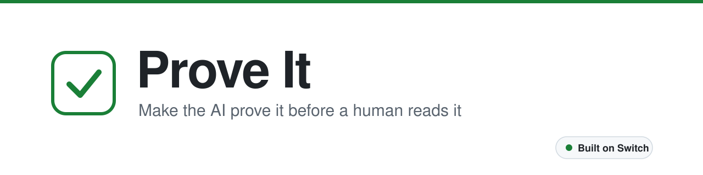
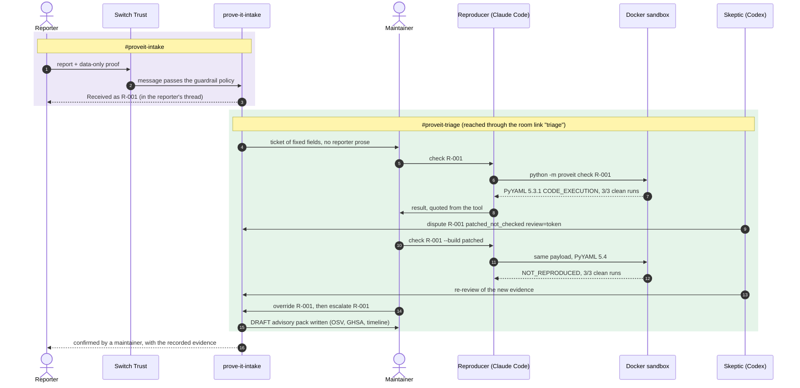
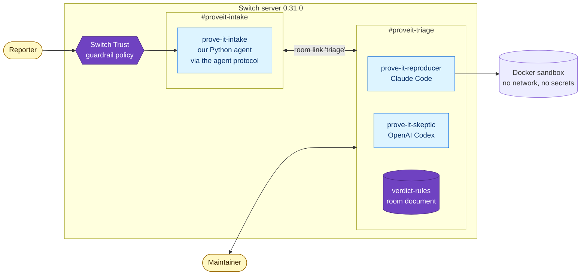
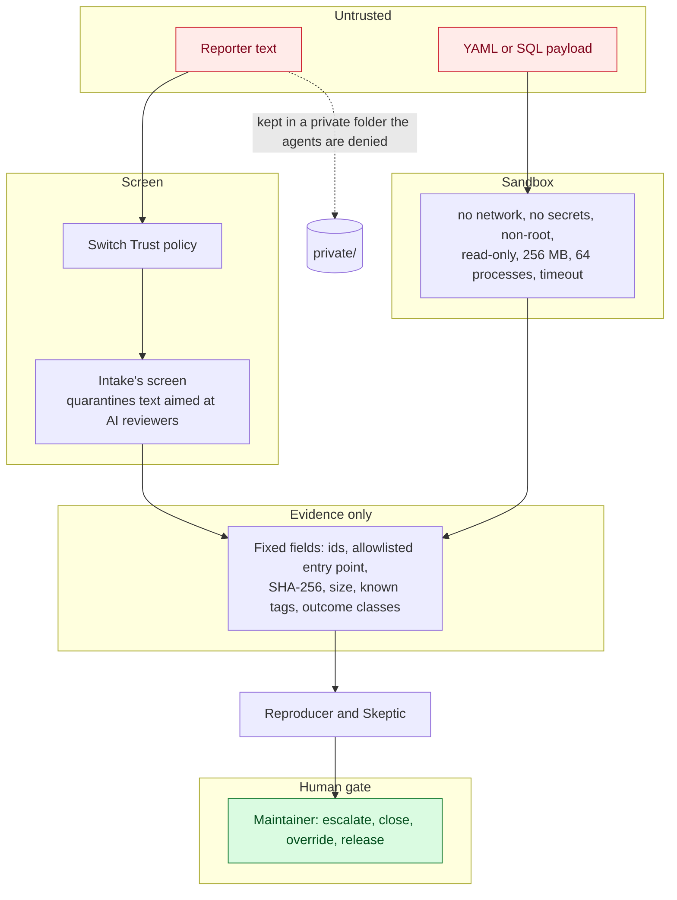
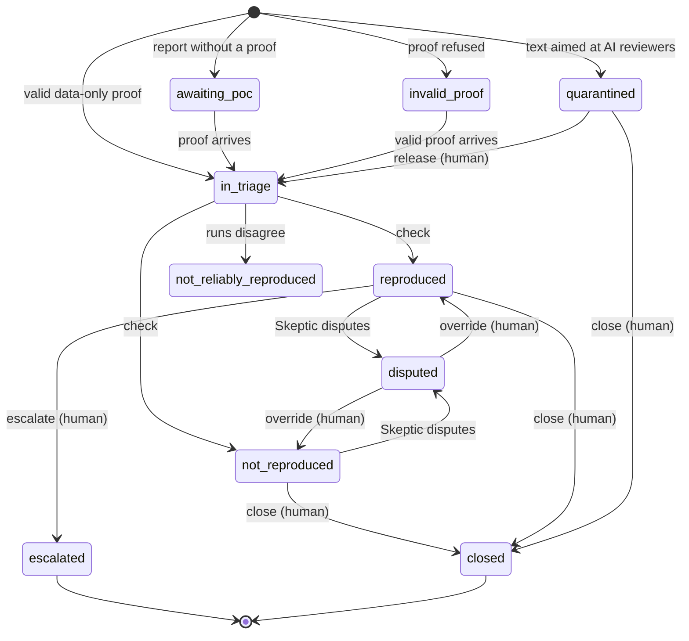

<p align="center">
  <picture>
    <source media="(prefers-color-scheme: dark)" srcset="docs/assets/banner-dark.svg">
    <source media="(prefers-color-scheme: light)" srcset="docs/assets/banner-light.svg">
    
  </picture>
</p>

<p align="center"><b>AI spam is drowning open source. Prove It makes the AI prove its bug report before a human reads it.</b></p>

<p align="center">
  <a href="https://github.com/akhilll0305/team-pikachu-switch-ai/actions/workflows/ci.yml"></a>
  <a href="#verified"></a>
  <a href="#verified"></a>
  <a href="LICENSE"></a>
  <a href="#where-switch-fits"></a>
</p>

<p align="center">
  <a href="#where-switch-fits"></a>
  <a href="#what-the-agents-can-and-cannot-touch"></a>
  <a href="agents/README.md"></a>
  <a href="agents/README.md"></a>
  
  
  
  
  
  
  
  <a href="#aligned-with-the-openssf-draft"></a>
  <a href="#the-advisory-pack"></a>
</p>

<p align="center">
  <a href="<VIDEO_LINK>"><b>Demo video</b></a> ·
  <a href="#one-report-end-to-end"><b>How it works</b></a> ·
  <a href="#where-switch-fits"><b>Where Switch fits</b></a> ·
  <a href="#results-from-real-runs"><b>Results</b></a> ·
  <a href="#run-it-yourself"><b>Run it yourself</b></a> ·
  <a href="#full-setup-in-switch-console-about-15-minutes"><b>Setup</b></a> ·
  <a href="#what-the-agents-can-and-cannot-touch"><b>Security model</b></a>
</p>

<table align="center">
  <tr>
    <td align="center"><h2>75 s</h2>fastest live verdict,<br>check to Skeptic</td>
    <td align="center"><h2>14×+</h2>faster than a 30–60 min<br>engineer first pass</td>
    <td align="center"><h2>18 / 18</h2>live sandbox runs<br>agreed with their check</td>
    <td align="center"><h2>35 / 35</h2>live Switch checks<br>passed</td>
    <td align="center"><h2>325</h2>tests passing,<br>CI green on main</td>
  </tr>
</table>

## Ten seconds to write, an hour to check

An AI writes a plausible vulnerability report in seconds; a maintainer still needs an hour to check one. In January 2026 curl [ended its bug bounty](https://www.theregister.com/2026/01/21/curl_ends_bug_bounty/) after its confirmed-vulnerability rate fell below 5%, and then [stopped accepting security reports for July](https://curl.se/dev/security.html). HackerOne [paused its Internet Bug Bounty](https://www.csoonline.com/article/4154216/internet-bug-bounty-program-hits-pause-on-payouts-2.html).

Elastic [received over 1,390 reports](https://www.elastic.co/security-labs/ai-vulnerability-triage-bug-bounty-hackerone) in the first half of 2026, and a senior security engineer spends 30 to 60 minutes on a typical one. From 11 September 2026 the EU Cyber Resilience Act requires an [early warning within 24 hours](https://eur-lex.europa.eu/legal-content/EN/TXT/?uri=CELEX:32024R2847) of an actively exploited vulnerability, so a real report buried under slop is now a legal risk.

Prove It moves the cost of proof back onto the reporter. **Code decides, agents argue, humans rule:** a sandbox classifies what the proof actually did, two agents from different vendors investigate and challenge it in a Switch room, and a maintainer makes every final call.

> [!IMPORTANT]
> We don't try to detect AI. Detection is unreliable. We require proof.

## How we use Switch

Prove It lives inside a Switch server. Three agents from three different sources, the reporter and the maintainers share two linked rooms, and every report, proof, check, verdict and decision moves through them.

**The agents we connected**

| Agent | Built on | Connected through | Job |
| --- | --- | --- | --- |
| `prove-it-intake` | Our own Python agent (standard library, no LLM) | The Switch agent protocol: an SSE stream per room, threaded `post_message`, `list_linked_rooms` | Screens every report, demands a data-only proof, owns the ticket state machine, answers the reporter in their thread |
| `prove-it-reproducer` | Claude Code | A Switch-managed agent created by the room template | Runs `python -m proveit check` in the Docker sandbox on the vulnerable and patched builds |
| `prove-it-skeptic` | OpenAI Codex | A Switch-managed agent created by the room template | Reads the evidence pack itself and posts `concur` or a reason-coded `dispute` |

**How the channels are set up**

- **`#proveit-intake`** is open to reporters. Switch Trust screens every human message before it enters the room, and only Intake answers there.
- **`#proveit-triage`** holds the maintainers and the three agents, with the room instructions and the `verdict-rules` room document.
- **A room link labelled `triage`** joins the two. Intake finds triage through the link and refuses to start without it.
- The Reproducer and Skeptic use `owner-agents` addressing: only the maintainer who deployed the template can instruct them, and reporters can reach Intake alone. "Bypass permissions" stays off (`auto_approve: false`).
- One template, [switch/prove-it.template.yaml](switch/prove-it.template.yaml), creates both agents, both rooms, the link, the instructions and the document in one deploy. [switch/prove-it.sqlparse.rooms.template.yaml](switch/prove-it.sqlparse.rooms.template.yaml) adds a second room pair for a second library, served by the same agents.

**How to set it up and run it:** the complete seven-step setup is in [Full setup in Switch Console](#full-setup-in-switch-console-about-15-minutes) below.

## One report, end to end



*Steps 3 to 16 are the exact sequence the managed Claude Code and Codex agents ran live for R-001 ([room posts](docs/evidence/live-trial-review4-2026-11-07/room-posts.md)); the Trust step is verified live in the [Trust log](docs/evidence/live-trust-2026-11-06-windows.log).*

## Where Switch fits



*Everything inside the Switch server box is a Switch feature Prove It uses; the sandbox is the only piece outside it.*

| Switch capability | What it does here | What breaks without it |
| --- | --- | --- |
| Agent protocol | Intake is our own client: SSE per room, heartbeats, threaded posts, `list_linked_rooms` ([switch_client.py](proveit/switch_client.py)) | No neutral way for our code to sit in a room beside vendor agents |
| Managed agents from two vendors | Reproducer on Claude Code, Skeptic on Codex, started and supervised by Switch | The challenger would share the investigator's blind spots |
| Rooms and threads | Reporters in intake, maintainers and agents in triage; every report answered in its own thread | Reporter text would sit next to the agents that run commands |
| Room links | Intake finds triage by the link labelled `triage`, and the sqlparse pair the same way | One Intake could not serve several room pairs with different rules |
| Agent addressing (`owner-agents`) | Only the deploying maintainer can instruct the Reproducer and Skeptic | A reporter could talk an agent into running a check |
| Room instructions and documents | The triage flow and `verdict-rules` live in the room | Every agent would need its own copy of the rules |
| Templates | One YAML deploys both agents, both rooms, the link, the instructions and the document | Setup becomes a page of manual clicks |
| Switch Trust | Blocks the prompt-injection report before Intake or any agent receives it | Hostile text reaches the first agent unscreened |

Switch is built for people and agents from different vendors working in one room, and Prove It puts exactly that to work. The same Intake serves two room pairs with different rules, work passes from reporter to agent to maintainer and back through threads, and Switch Trust guards the entry point.

## What the agents can and cannot touch



*Reporter text never crosses into the evidence the agents read; only fixed fields and the sandbox's own observations do.*

- **Proofs are data, not code.** An allowlisted library entry point and a UTF-8 payload of at most 64 KB. 8 forged-proof shapes, from Python scripts to unsafe loaders, are rejected before Docker is ever called ([tests/test_poc.py](tests/test_poc.py)).
- **The harness runs outside the library call.** A parent process starts a child that makes one library call, and the parent alone decides the outcome from exit status, signal, time, memory and a marker file ([target/harness.py](target/harness.py)).
- **The result line can't be forged.** The one-time code that tags it never enters the child, and the parent is non-dumpable. 8 audit cheats are tested against it ([tests/test_sandbox.py](tests/test_sandbox.py), `AuditCheats`).
- **A canary proves no reporter text reaches an agent.** It plants a unique string in a report and checks every ticket, run record, evidence pack and triage post (`Canary` in [tests/test_sandbox.py](tests/test_sandbox.py)).
- **Each agent is locked to its own folder.** Claude Code and Codex allow only the `python -m proveit` commands each needs, and the folder fixes the role so an agent can't claim to be human ([agents/README.md](agents/README.md), [tests/test_agent_folders.py](tests/test_agent_folders.py)).
- **Bypass permissions stays off.** The template sets `auto_approve: false` for both agents, and only maintainers can escalate, close, override, release or lift a reporter limit.

<details>
<summary><b>How we made forgery impossible</b></summary>

An audit of an early version attacked the sandbox the way a dishonest reporter would. Each cheat now fails by construction, and each has a test:

| Cheat | What stops it |
| --- | --- |
| Print a fake `REPRODUCED` result line | The parent writes the result, tagged with a one-time code the child never sees |
| Read the one-time code through `/proc` | The parent marks itself non-dumpable |
| `time.sleep` to "prove" a denial of service | Python code is refused; an idle timeout is `INCONCLUSIVE`, never exhaustion |
| `ctypes.string_at(0)` to "prove" a crash | Python code is refused before any run |
| `yaml.unsafe_load` to "prove" code execution | Unsafe-by-design loaders are out of scope and refused at intake |
| Write the marker file without the library | Nothing but the one library call runs in the child |
| Report a fake `MemoryError` | Exhaustion needs the parent's own memory observation to agree |
| One huge allocation dressed up as a bug | Classified from observed behaviour, not from the child's story |

</details>

## Ticket lifecycle



*One table in [proveit/states.py](proveit/states.py) enforces every move, with 73 transition cases tested in [tests/test_states.py](tests/test_states.py).* Only humans escalate, close or override, a dispute blocks escalation until a maintainer overrides it, and a quarantined report can never be escalated.

## Results from real runs

**Live in Switch Console with managed Claude Code and Codex agents: two real CVEs reproduced on the vulnerable build and cleared on the patched one, 18 of 18 sandbox runs consistent, every check-to-verdict time under 2 minutes 10 seconds.**

| Report (live, 2026-11-07) | Vulnerable build | Patched build | Skeptic | Final status | Check to Skeptic verdict | Evidence |
| --- | --- | --- | --- | --- | --- | --- |
| R-001 PyYAML, CVE-2020-14343 via `full_load` | 5.3.1: `CODE_EXECUTION`, 3/3 | 5.4: `NOT_REPRODUCED`, 3/3 | `dispute patched_not_checked`, then re-review | escalated, advisory pack written | 75 s | [ticket](docs/evidence/live-trial-review4-2026-11-07/tickets/R-001/) |
| R-004 sqlparse, CVE-2023-30608 via `parse` | 0.4.3: `RESOURCE_EXHAUSTION`, 3/3 (10.005 s) | 0.4.4: `NOT_REPRODUCED`, 3/3 (0.066 s) | `dispute patched_not_checked`, then re-review | escalated, advisory pack written | 127 s | [ticket](docs/evidence/live-trial-review4-2026-11-07/tickets/R-004/) |
| R-006 sqlparse, `SELECT 1;` claimed as DoS | 0.4.3: `NOT_REPRODUCED`, 3/3 | not needed | `concur` | closed | 31 s after the result | [ticket](docs/evidence/live-trial-review4-2026-11-07/tickets/R-006/) |
| R-007 sqlparse, `SELECT 2;` claimed as DoS | 0.4.3: `NOT_REPRODUCED`, 3/3 | not needed | `concur` | closed | 29 s after the result | [ticket](docs/evidence/live-trial-review4-2026-11-07/tickets/R-007/) |

*Times come from the Mattermost post timestamps in [room-posts.md](docs/evidence/live-trial-review4-2026-11-07/room-posts.md). Intake refused the Skeptic's concur 4 times while its own dispute stood, and the reporter limit engaged after 2 failed proofs and was lifted by the maintainer.*

| First pass on a report | Time | Against a 30 min engineer pass | Against a 60 min engineer pass |
| --- | --- | --- | --- |
| R-001, PyYAML CVE, check to Skeptic verdict | 75 s | 24× faster | 48× faster |
| R-004, sqlparse CVE, check to Skeptic verdict | 127 s | 14× faster | 28× faster |
| Senior security engineer, typical report | 30–60 min | | |

*Agent times from the live room posts; the 30–60 minute engineer figure is Elastic's, from [Elastic Security Labs](https://www.elastic.co/security-labs/ai-vulnerability-triage-bug-bounty-hackerone).*

**Scorecard**

| Measure | Result | Source |
| --- | --- | --- |
| Tests | 325 passing, 0 failures | [docs/SETUP.md](docs/SETUP.md), CI |
| CI on `main` | 5 of 5 pushes green, Linux and Windows jobs | [Actions](https://github.com/akhilll0305/team-pikachu-switch-ai/actions/workflows/ci.yml) |
| Headless Switch live checks | 35 / 35 passed | [live-checks log](docs/evidence/live-checks-2026-11-07-headless.log) |
| Headless Switch end-to-end | `E2E PASSED` on Windows and macOS | [Windows](docs/evidence/e2e-2026-11-05.log), [macOS](docs/evidence/e2e-2026-11-05-macos.log) |
| PyYAML rehearsal, run twice | identical, digest `d7ad7ae2c8b6294c` | [fix-pass log](docs/evidence/fix-pass-2026-11-07-windows.log) |
| sqlparse rehearsal, run twice | identical, digest `c34d857c31d97fb6` | [fix-pass log](docs/evidence/fix-pass-2026-11-07-windows.log) |
| Switch Trust | report 04 blocked before the room; every real report, proof and command passed unchanged | [Trust log](docs/evidence/live-trust-2026-11-06-windows.log) |
| Test code vs product code | 4,434 lines of tests for 5,071 lines in `proveit/` | `tests/`, `proveit/` |

Battle-tested against replays of 2 real CVEs, 4 purpose-built false and out-of-scope claims in the style of [curl's public AI-slop collection](https://gist.github.com/bagder/07f7581f6e3d78ef37dfbfc81fd1d1cd), and a purpose-built prompt-injection report ([reports/replays](reports/replays)), every one with a known expected outcome.

## Run it yourself

**Offline in three commands** (Python 3.9+ and Docker; nothing to `pip install`):

```sh
python -m proveit build                     # builds the PyYAML 5.3.1 and 5.4 sandbox images
python -m unittest discover -s tests        # 325 tests
python scripts/rehearse.py --twice          # replays all four PyYAML reports twice and compares
```

The rehearsal ends with:

```
**Tally:** 4 reports. By status: 2 closed, 1 escalated, 1 quarantined. By outcome: 1 CODE_EXECUTION, 2 NOT_REPRODUCED, 1 not run. ...
REHEARSAL PASSED (both runs identical)
```

### Full setup in Switch Console (about 15 minutes)

Tested on Windows 11 with Switch Console 0.40.1, Switch server 0.31.0, Claude Code 2.1.318, Codex 0.166.0, Docker 29.9.2 and Python 3.13.3. You need Docker running, Python 3.9+, Switch Console, and Claude Code and Codex installed.

**1. Get the code and build the sandbox**

```sh
git clone https://github.com/akhilll0305/team-pikachu-switch-ai
cd team-pikachu-switch-ai
python -m proveit build                     # PyYAML 5.3.1 (vulnerable) and 5.4 (patched) images
python -m proveit build --target sqlparse   # sqlparse 0.4.3 and 0.4.4 images, for the second room pair
python scripts/rehearse.py                  # the whole flow offline, no Switch
```

**2. Start a Switch server.** In Switch Console: **Add a server → Run a server on this computer → Start**, and wait for **Running locally**. Open **Home → Messaging apps → Mattermost → Sign-in details… → Open in Mattermost** and sign in. Under **Settings → Agent providers**, confirm Claude Code and Codex both show **Signed in** (`claude auth login`, `codex login`).

**3. Register the Intake agent.** Intake is our own agent on the Switch agent protocol, so this command registers it with Console's local server and opens it to everyone in its rooms:

```sh
python -m proveit.intake setup
```

Credentials are stored in `~/.proveit/`, outside the checkout. Use `--env-file` and `--api-url` for a server elsewhere, and `--overwrite` to re-register.

**4. Deploy the template.** In Console open **Templates**, add a template from YAML and paste [switch/prove-it.template.yaml](switch/prove-it.template.yaml).

- **Prove It checkout:** the folder you cloned. Select the box, press Ctrl+A and paste the path once; the **Preview** must show `<checkout>/agents/reproducer` and `<checkout>/agents/skeptic`.
- **Reproducer runs on / Skeptic runs on** (Advanced): Claude Code and Codex by default. Keep them on different vendors.
- Click **Create all**. You get `prove-it-reproducer`, `prove-it-skeptic` and a **Prove It** room group with `#proveit-intake` and `#proveit-triage`, linked as `triage`, with the room instructions and the `verdict-rules` and `scope-policy` documents. For the sqlparse rooms, add [switch/prove-it.sqlparse.rooms.template.yaml](switch/prove-it.sqlparse.rooms.template.yaml) the same way.

Then, for each agent: confirm **Bypass permissions** is off, and trust its folder once so its lockdown applies (run `claude` in `agents/reproducer` and accept the trust prompt; run `codex` in `agents/skeptic` and trust the project).

**5. Turn on Switch Trust.**

1. Sign up at [app.switchagents.ai](https://app.switchagents.ai/).
2. **Settings → Configurations → Guardrail policies → Add policy**, named `Prove It guard`. Turn on **Regex** for the **User** role only, Action **Block**, with these two patterns, and leave every other detector off (including Jailbreak, which blocks legitimate proofs):
   ```
   (?i)ignore\s+((all|your|previous)\s+)+(instructions|rules)
   (?i)print (your )?env(ironment)?
   ```
3. **Settings → Admin → API keys → Create key** with Role **Editor**, and copy it.
4. In Console, on the server's **Home** page, open **Switch Trust Integration** and set the endpoint `https://api.switchagents.ai`, the policy ID and the key. It shows **Monitoring Active** at once.

**6. Run Intake** and leave it running:

```sh
python -m proveit.intake run
```

It prints `Intake is listening in #proveit-intake and the room it links to as 'triage'`.

**7. Try it.** Post a report in `#proveit-intake`, or replay ours as your Mattermost user:

```sh
python scripts/replay.py report 01        # real CVE-2020-14343
python scripts/replay.py report 02        # slop with no proof: Intake asks for one
python scripts/replay.py followup 02      # the "proof"
python scripts/replay.py report 03        # slop: billion laughs
python scripts/replay.py report 04        # injection: blocked by Switch Trust
```

Then decide it in `#proveit-triage`:

```
@prove-it-reproducer check R-001
@prove-it-reproducer run R-001 on the patched build
@prove-it-skeptic review R-001
@prove-it-intake override R-001 patched build checked
@prove-it-intake escalate R-001 confirmed, CVE-2020-14343
@prove-it-intake close R-002 reason=not_reproduced safe_load refused the tag
@prove-it-intake tally
```

The full guide, with every Console click, is [docs/SETUP.md](docs/SETUP.md). `python -m proveit doctor` checks Docker, the images, Intake, the rooms, the maintainers and the agents' folders and says what to fix, and every Switch issue we met has a tested workaround in [SETUP troubleshooting](docs/SETUP.md#troubleshooting).

<details>
<summary><b>Headless Switch server, no Console needed</b></summary>

```sh
bash scripts/switch-server.sh up                              # Switch 0.31.0 + Mattermost on ports 18000 / 18065
python scripts/e2e.py --env-file .proveit/switch-server/.env  # every replay through real rooms; ends with E2E PASSED
bash scripts/switch-server.sh reset && bash scripts/switch-server.sh up
python -m proveit build --target sqlparse
python scripts/live_checks.py --env-file .proveit/switch-server/.env   # 35 checks; ends with LIVE CHECKS PASSED
```

`live_checks.py` deploys both room templates unmodified through Switch, uses separate reporter and maintainer accounts, and checks reason-coded disputes, the reporter's fixed question, the advisory pack, the reporter limit and a sqlparse report on both builds. On Windows, run the `.sh` script from Git Bash.

</details>

<details>
<summary><b>Commands</b></summary>

| Command | Who | What it does |
| --- | --- | --- |
| `python -m proveit check R-001 [--build patched] [--loader safe_load]` | Reproducer, maintainer | 3 runs in fresh containers; sets `reproduced`, `not_reproduced` or `not_reliably_reproduced` |
| `python -m proveit evidence R-001` | anyone | The evidence pack, the Skeptic's checklist and its review token |
| `@prove-it-intake concur R-001 review=<token>` / `dispute R-001 <reason_code> review=<token>` | Skeptic | Record a verdict; a dispute blocks escalation |
| `@prove-it-intake escalate R-001 [note]` | maintainer | Decide; the reporter is told and the DRAFT advisory pack is written |
| `@prove-it-intake close R-001 [reason=<code>] <note>` | maintainer | Close; the reporter gets at most one fixed question |
| `@prove-it-intake override R-001` / `release R-001` | maintainer | Clear a dispute, or send a quarantined report on |
| `python -m proveit clear-reporter <key>` | maintainer | Lift a reporter's one-open-report limit |
| `python -m proveit list` / `show R-001` / `tally` / `doctor` | anyone | Tickets, one ticket, totals, a setup check |

Reason codes: `not_reproduced`, `not_clean_reproducible`, `also_on_patched`, `out_of_scope_api`, `outcome_mismatch`, `severity_overclaimed`, `version_missing`, `patched_not_checked`.

</details>

<details>
<summary><b>Outcome classes</b></summary>

| Outcome | Meaning |
| --- | --- |
| `CODE_EXECUTION` | The marker file appeared; only the library running the payload as code can create it |
| `CRASH` | The library call died on a native fault (SIGSEGV, SIGBUS, SIGABRT, SIGFPE, SIGILL) |
| `RESOURCE_EXHAUSTION` | A busy CPU timeout, a resource-limit signal, or a MemoryError backed by observed memory |
| `NOT_REPRODUCED` | The call returned or raised normally |
| `NOT_RELIABLY_REPRODUCED` | The 3 clean runs disagreed; escalating needs a maintainer's override |
| `INVALID_PROOF` | Not run: Python code, an unsafe or unknown entry point, or a payload too large or not UTF-8 |
| `INCONCLUSIVE` | The sandbox could not establish a result |

</details>

### The advisory pack

Every escalation writes `work/R-NNN/advisory/`: an [OSV](https://ossf.github.io/osv-schema/) draft, a GitHub Security Advisory draft and a timestamped timeline in Markdown and JSON, all marked "DRAFT, needs maintainer review". The payload appears only as its SHA-256, size and known tags, and the timeline gives a manufacturer the trail the Cyber Resilience Act's 24-hour early warning asks for. Live examples: [R-001](docs/evidence/live-trial-review4-2026-11-07/tickets/R-001/advisory/) and [R-004](docs/evidence/live-trial-review4-2026-11-07/tickets/R-004/advisory/).

## Project structure

```
proveit/            Intake agent, Switch protocol client, sandbox runner, state machine, CLI
target/             PyYAML sandbox image: parent harness and one-call child
target-sqlparse/    sqlparse sandbox image, both versions pinned by SHA-256
agents/             Reproducer (Claude Code) and Skeptic (Codex) folders with permission lockdowns
switch/             Switch templates: agents, rooms, link, instructions, room document
reports/replays/    replayed CVE reports, slop reports and the injection report
scripts/            rehearsal, headless Switch server, end-to-end and live checks, replay driver
tests/              325 tests, including the OSV schema they validate against
docs/               setup guide, demo flow, scope policies, evidence from every recorded run
```

Python (standard library only), Docker, YAML templates for Switch, Mermaid, GitHub Actions on Ubuntu and Windows.

## Aligned with the OpenSSF draft

[OpenSSF issue #178](https://github.com/ossf/wg-vulnerability-disclosures/issues/178) collects practices for handling AI-written vulnerability reports. Prove It implements these:

| Practice | How Prove It implements it |
| --- | --- |
| Dynamic proof is mandatory | No runnable data-only proof, no ticket in triage |
| Reproduce N times from a clean state | 3 sequential runs in fresh containers; disagreement gives `NOT_RELIABLY_REPRODUCED` |
| Verify the runner's own tally | The parent process decides the outcome; the child's report is untrusted |
| Publish a threat model and scope | [PyYAML](docs/policy/pyyaml-scope.md) and [sqlparse](docs/policy/sqlparse-scope.md) scope policies, enforced before any run |
| Steps to reproduce, including version | `affected_version` is a required field of every proof |
| A templated rejection naming the missing element | Reason codes, each with one fixed reporter question |
| Managing repeat submitters | After 2 failed proofs, one open report at a time; lifted by a maintainer, never a ban |
| A human gates every external send | Only maintainers decide; reporter messages are fixed text plus recorded results |

## Verified

| What | How | Record |
| --- | --- | --- |
| Full workflow with managed Claude Code and Codex agents | Live in Switch Console: two CVEs escalated with advisory packs, two false claims closed, reporter limit engaged and lifted | [live trial](docs/evidence/live-trial-review4-2026-11-07/README.md) |
| Switch Trust in front of intake | Live: injection report blocked before any agent; real reports untouched | [Trust log](docs/evidence/live-trust-2026-11-06-windows.log) |
| Disputes, advisory pack, reporter limit, separate accounts, sqlparse rooms | Headless Switch 0.31.0, 35 / 35 checks | [live-checks log](docs/evidence/live-checks-2026-11-07-headless.log) |
| Intake over real Switch rooms and Mattermost | Headless end-to-end, Windows and macOS | [e2e log](docs/evidence/e2e-2026-11-05.log) |
| Sandbox isolation, audit cheats, canary, state machine | 325 tests offline and in CI | [tests/](tests), [CI](https://github.com/akhilll0305/team-pikachu-switch-ai/actions/workflows/ci.yml) |
| Deterministic outcomes | Both rehearsals identical across runs | [fix-pass log](docs/evidence/fix-pass-2026-11-07-windows.log) |

## Contributing back to Switch

Running two vendors' agents, a custom protocol agent and Trust together on real hardware surfaced platform behaviour worth sharing upstream. Each finding is documented with its symptom and a working fix in [SETUP troubleshooting](docs/SETUP.md#troubleshooting):

- Recreated agent bot accounts lose membership of private rooms, so their posts are refused until re-invited.
- WSL's mirrored networking makes IPv6 `localhost` hang, timing out the server's websocket to Mattermost.
- A stale process id in the agent controller's health file blocks status reports on Windows.
- A Switch-managed Codex session does not apply `PYTHONPATH` from its project config; our agent folders now locate the package themselves.
- Switch Trust's Jailbreak detector blocks legitimate proofs, because a bug report's proof describes an attack; a regex-only policy fixes it.

## Team Pikachu

[@akhilll0305](https://github.com/akhilll0305) · [@Siddharthpandey20](https://github.com/Siddharthpandey20) · [@Utkarsh240102](https://github.com/Utkarsh240102) · [@SidVaidya2005](https://github.com/SidVaidya2005)

Built for the [Flip the Switch hackathon](https://www.wemakedevs.org/hackathons/switch), Track 1: Best Business Workflow.

## License

[MIT](LICENSE).

## Sources

- curl ends its bug bounty: [The Register, 2026-01-21](https://www.theregister.com/2026/01/21/curl_ends_bug_bounty/)
- curl security reporting: [curl.se/dev/security.html](https://curl.se/dev/security.html)
- HackerOne pauses the Internet Bug Bounty: [CSO Online](https://www.csoonline.com/article/4154216/internet-bug-bounty-program-hits-pause-on-payouts-2.html)
- Elastic's report volume and engineer time: [Elastic Security Labs, 2026-08-04](https://www.elastic.co/security-labs/ai-vulnerability-triage-bug-bounty-hackerone)
- EU Cyber Resilience Act, Art. 14(2)(a) and Art. 71: [Regulation (EU) 2024/2847](https://eur-lex.europa.eu/legal-content/EN/TXT/?uri=CELEX:32024R2847)
- curl's public AI-slop reports: [gist by Daniel Stenberg](https://gist.github.com/bagder/07f7581f6e3d78ef37dfbfc81fd1d1cd)
- OpenSSF AI-slop practices: [ossf/wg-vulnerability-disclosures#178](https://github.com/ossf/wg-vulnerability-disclosures/issues/178)
- CVE-2020-14343: [NVD](https://nvd.nist.gov/vuln/detail/CVE-2020-14343); CVE-2023-30608: [GHSA-rrm6-wvj7-cwh2](https://github.com/andialbrecht/sqlparse/security/advisories/GHSA-rrm6-wvj7-cwh2)
- OSV schema: [ossf.github.io/osv-schema](https://ossf.github.io/osv-schema/)
