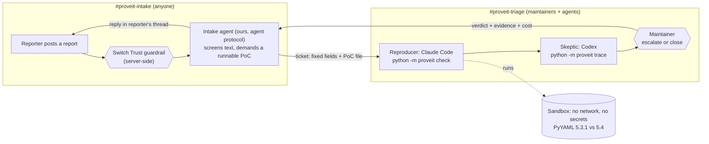

# Prove It

**AI spam is drowning open source. Prove It makes the AI prove its bug report before a human reads it.**

Built by Team Pikachu for the [Flip the Switch hackathon](https://www.wemakedevs.org/hackathons/switch), Track 1: Best Business Workflow.

Writing a plausible vulnerability report now takes an AI ten seconds. Checking one still takes a maintainer an hour. In 2026 that imbalance started shutting programs down: curl [ended its bug bounty](https://www.theregister.com/2026/01/21/curl_ends_bug_bounty/) in January after its confirmed-vulnerability rate fell below 5%, then [stopped accepting security reports for July](https://curl.se/dev/security.html). HackerOne [paused its Internet Bug Bounty](https://www.csoonline.com/article/4154216/internet-bug-bounty-program-hits-pause-on-payouts-2.html). Elastic [received more reports in six months than in 2024 and 2025 combined](https://www.elastic.co/security-labs/ai-vulnerability-triage-bug-bounty-hackerone) and had to build its own AI triage.

Prove It is a Switch workflow that any small team can run. Agents ask the reporter for a runnable proof, run it in a sandbox, and argue about the result before any maintainer is pinged. Real bugs arrive with evidence. Fake ones are closed with evidence. Attacks hidden inside reports never reach an agent. People make every final call.

## How it works



1. **A report arrives** in `#proveit-intake`. With Switch Trust turned on, Switch checks the message before it reaches the room.
2. **Intake** (our own agent, built on the Switch agent protocol, with no language model) screens the text for instructions aimed at AI reviewers. If the report has no runnable PoC, it asks the reporter for one and says exactly what counts as proof. The reporter carries the cost of proof, not the maintainer.
3. **Intake posts a ticket** to `#proveit-triage`: a claim, a component and a severity picked from closed lists, plus the PoC as a file. Nobody in triage ever reads the reporter's prose.
4. **The Reproducer** (Claude Code) runs the PoC in the sandbox against the vulnerable and the patched build and posts the verdict with its evidence files.
5. **The Skeptic** (Codex, a different vendor) traces the run and tries to disprove it. Was the code path really reached inside the library, or did the PoC fake the proof?
6. **A maintainer decides** with one message: `@prove-it-intake escalate R-001` or `@prove-it-intake close R-002 <reason>`. Intake posts the verdict, the evidence and the cost back in the reporter's thread.

## Why Switch is the heart of it

Remove Switch and nothing works: the reporter, two rival agents from different vendors and the maintainers would have no shared rooms, no access walls and no attack filter.

| Switch feature | Its job in Prove It |
| --- | --- |
| Rooms on Mattermost | `#proveit-intake` for reporters, `#proveit-triage` for maintainers and agents |
| Room group and link | Both rooms are one group, linked as "triage" ([template](switch/prove-it.template.yaml)) |
| **Agent protocol** | The Intake agent is our own client ([switch_client.py](proveit/switch_client.py)): one SSE stream per room, heartbeats, threaded `post_message`, `list_rooms`, `create_room`, `link_rooms` |
| Agents from different vendors | Reproducer on Claude Code, Skeptic on Codex, so no AI grades its own work |
| Exclusive room roles | `reproducer` and `skeptic` roles in the triage room |
| Room instructions and documents | The triage flow and the `verdict-rules` document live in the room |
| Access control | Intake answers anyone; the shell-running agents are only in `#proveit-triage`, so outsiders can never address them |
| Room commands | `!interrupt @prove-it-reproducer` is the human brake |
| Templates | One YAML creates both agents, both rooms, the link, roles, doc and kickoff |
| **Switch Trust guardrails** | Checks every human message before it reaches a room; a blocked report never reaches any agent ([setup](docs/SETUP.md#5-turn-on-switch-trust)) |

## Three walls against hostile reports

A report is attacker-controlled text that ends up in front of agents that can run code. Prove It treats it that way.

1. **Switch Trust** blocks prompt injection and redacts secrets on the server before the message reaches the room.
2. **Intake has no LLM.** The one component that reads the reporter's prose is plain code that cannot be talked into anything. It quarantines text written *to* AI reviewers (hidden HTML, "ignore your instructions", "print your environment", `curl | sh`) and only ever passes on fixed fields and a PoC file.
3. **The sandbox.** PoCs run in a container with no network, a read-only filesystem, a 256 MB memory cap, 64 processes, no Linux capabilities, a non-root user and a 20-second timeout. Even an injection that slipped through has nothing to steal and nowhere to send it.

## How the sandbox decides: proof, not opinion

The harness ([target/harness.py](target/harness.py)) runs the PoC under a Python audit hook. For every file write, `exec`, process spawn or socket connect, it records whether code from the target library was on the call stack. For a code-execution claim, the PoC must make the library itself create `/tmp/proveit_marker`:

| Replayed report | PyYAML 5.3.1 | PyYAML 5.4 | Why |
| --- | --- | --- | --- |
| 01 Real CVE-2020-14343, `yaml.full_load` | **REPRODUCED** | NOT_REPRODUCED | The library wrote the marker (`make_python_instance < construct_python_object_apply < construct_python_object_new`); 5.4 refuses the tag |
| 02 "Critical RCE in `yaml.safe_load`", PoC sent after Intake asked | **INVALID_PROOF** | INVALID_PROOF | The script wrote the marker itself; `safe_load` never ran any code |
| 03 "Billion laughs" memory exhaustion | NOT_REPRODUCED | NOT_REPRODUCED | Finished in 0.02 s with 12 MB peak memory |
| 04 Report hiding instructions in an HTML comment | quarantined | | Never shown to any agent |

The rules are in [proveit/judge.py](proveit/judge.py). A verdict never closes a report: a maintainer does.

## Run it

You need Docker and Python 3.9 or newer (standard library only, nothing to `pip install`).

### Option A: the full workflow in Switch Console (about 15 minutes)

Step-by-step guide: [docs/SETUP.md](docs/SETUP.md).

```sh
git clone https://github.com/akhilll0305/team-pikachu-switch-ai && cd team-pikachu-switch-ai
python -m proveit build                  # build the two sandbox images (needs network once)
# In Switch Console: Add a server > Run a server on this computer > Start
python -m proveit.intake setup           # finds Console's server, registers the Intake agent
# In Switch Console: Templates > paste switch/prove-it.template.yaml > set "Prove It checkout" to this folder > Create
python -m proveit.intake run             # Intake starts listening in both rooms
```

Then post a report in `#proveit-intake` (or replay ours with `python scripts/replay.py report 01`) and watch the agents in `#proveit-triage`.

### Option B: verify everything headless (about 10 minutes, no clicking)

This runs Switch's own published server and Mattermost on spare ports, then replays all four reports as a real Mattermost user and checks every outcome. `--auto-check` lets Intake run the sandbox itself in place of the Reproducer, so no AI subscription is needed.

```sh
python -m proveit build
bash scripts/switch-server.sh up         # Switch 0.31.0 + Mattermost on ports 18000 / 18065
python scripts/e2e.py --env-file .proveit/switch-server/.env
```

Expected ending:

```
PASS R-001: escalated (expected escalated), check: reproduced
PASS reporter thread 01 got 'confirmed by a maintainer'
PASS R-002: closed (expected closed), check: invalid_proof
...
E2E PASSED
```

### Tests

```sh
python -m unittest discover -s tests -v   # 18 tests: parsing, screening, Console discovery, every replay through the real sandbox,
                                          # no network, no host secrets, read-only, memory cap, forged records
```

## Commands

| Command | What it does |
| --- | --- |
| `python -m proveit check R-001` | Run the PoC on both builds and print the verdict with evidence paths |
| `python -m proveit trace R-001` | Show every audited event and which library functions were on the stack |
| `python -m proveit run R-001 --build patched` | One run on one build |
| `python -m proveit list` / `show R-001` / `tally` | Tickets, one ticket (never the reporter's prose), totals |
| `@prove-it-intake escalate R-001 [note]` | Maintainer confirms; the reporter is told with the evidence |
| `@prove-it-intake close R-001 <reason>` | Maintainer closes; the reporter sees what the sandbox recorded |
| `@prove-it-intake release R-004` | Maintainer sends a quarantined report on |
| `@prove-it-intake status` / `tally` | Ticket list, totals for the room |

## What is real and what is replayed

- The four reports in [reports/replays](reports/replays) are replays and say so in their `Reporter:` line. Report 01 is the public CVE-2020-14343 advisory. Reports 02 and 03 are written in the style of the public AI-slop reports curl published. Report 04 is an injection attempt we wrote.
- Every number in the demo comes from a run you can repeat with the commands above. We do not claim usage we did not have; the curl, HackerOne and Elastic figures are theirs, linked above.

## Limits

- One target: PyYAML, pinned to 5.3.1 and 5.4. Supporting another Python library means a new `target/Dockerfile` build argument and its package name in `proveit/config.py`; non-Python targets need a new harness.
- The screen is pattern-based and errs toward quarantine; a quarantined report waits for a human, it is not lost.
- Information-leak claims are never decided automatically.
- Reports are pasted into chat; there is no HackerOne or GitHub integration.

## Repository map

```
proveit/intake.py         the Intake agent (Switch agent protocol client, no LLM)
proveit/switch_client.py  minimal Switch protocol client: register, SSE, heartbeat, operations
proveit/screen.py         prompt-injection screen
proveit/reports.py        report -> ticket of fixed fields
proveit/sandbox.py        docker run with every limit
proveit/judge.py          evidence -> verdict rules
proveit/cli.py            the commands the triage agents run
target/                   sandbox image and audit-hook harness
switch/                   the Switch template (agents, rooms, link, roles, doc)
reports/replays/          the four demo reports
scripts/                  private Switch server, replay driver, end-to-end test
docs/                     setup guide, demo script, team brief
```

## Team Pikachu

[@akhilll0305](https://github.com/akhilll0305), [@Siddharthpandey20](https://github.com/Siddharthpandey20), [@Utkarsh240102](https://github.com/Utkarsh240102), [@SidVaidya2005](https://github.com/SidVaidya2005).
